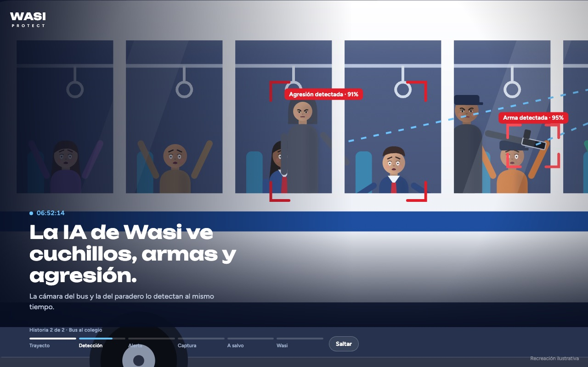
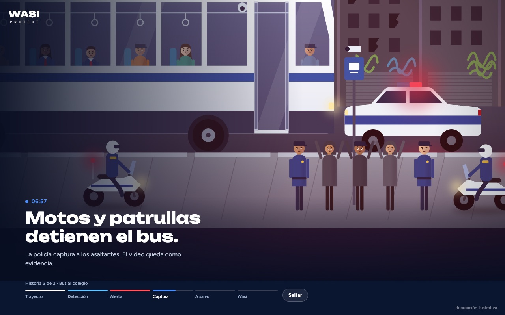
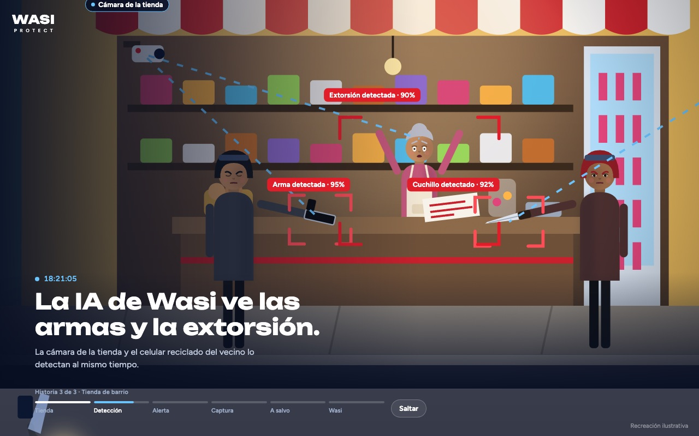
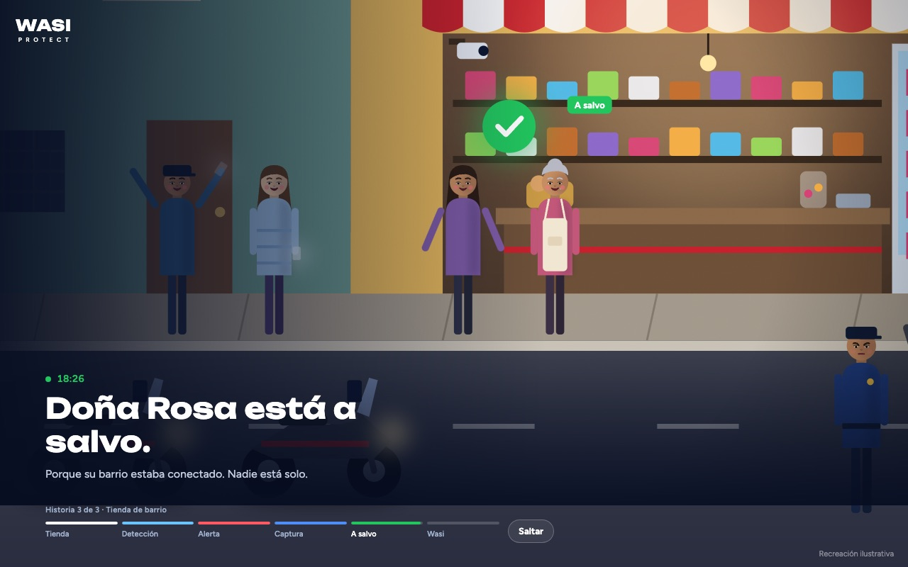

# Wasi Protect · Historias animadas

Tres historias interactivas de unos 40 segundos cada una que muestran cómo funciona **Wasi**: la IA detecta el peligro, la alerta llega a toda la comunidad y todos terminan a salvo. Cada una cierra con la marca: **Wasi detecta · Wasi alerta · Wasi protege · Wasi somos todos · Únete**.

1. **Camino a casa:** Valentina, 12 años, vuelve sola de noche y una camioneta se detiene a su lado.
2. **Bus al colegio:** Mateo, 15 años, va en bus a su colegio y suben asaltantes con cuchillo y arma.
3. **Tienda de barrio:** Doña Rosa, 62 años, atiende su tienda y llegan dos motorizados armados a robar y extorsionar.

Al terminar cada historia, el cierre queda en **Únete** 7 segundos y empieza sola la siguiente.

Hecho con **Expo (React Native)**, **Skia** y **Reanimated**. El mismo código funciona en **web, iOS y Android**.

| Detección | Alerta |
| --- | --- |
|  |  |
| **Historia 2: cuchillo, arma y agresión** | **Historia 2: la policía detiene el bus** |
|  |  |
| **Historia 3: arma, cuchillo y extorsión** | **Historia 3: Doña Rosa a salvo** |
|  |  |
| **Wasi detecta · alerta · protege** | **Wasi somos todos · Únete** |
|  |  |

**Ver en línea:** https://diegofrans2024.github.io/wasi-hero/ (también `?h=2` o `?h=3` para empezar en otra historia)

---

## Inicio rápido

Necesitas **Node.js 20 o superior**.

```bash
git clone git@github.com:DiegoFrans2024/wasi-hero.git
cd wasi-hero
npm install          # instala todo y prepara Skia para la web
npm run web          # abre la historia en el navegador
```

Se abre en **http://localhost:8081**.

### En el celular

```bash
npx expo start
```

Escanea el código QR con la app **Expo Go** (Android) o con la cámara (iPhone). Si alguna librería no carga en Expo Go, crea una *development build* con `npx expo run:ios` o `npx expo run:android`.

---

## Las historias, segundo a segundo

Las tres historias usan los mismos tiempos; cambian la escena y los textos. En todas, cuando llega la alerta, a cada persona le suena el celular (pantalla roja, ondas y vibración) y aparece como notificación de Wasi.

| Segundo | Momento | 1 · Camino a casa | 2 · Bus al colegio | 3 · Tienda de barrio |
| --- | --- | --- | --- | --- |
| 0 | **Inicio** | Valentina, 12 años, vuelve sola. Una camioneta se detiene a su lado. | Mateo, 15 años, va en bus. La ruta entra a un sector peligroso; en el paradero esperan tres hombres. | Doña Rosa, 62 años, atiende a una clienta. Dos motos se detienen en su puerta. |
| 6 | **Detección** | Una cámara IP, un celular reciclado y un dron detectan el arma y el susto. | La cámara del bus y la del paradero detectan el cuchillo, el arma y la agresión a Mateo. | La cámara de la tienda y el celular reciclado del vecino detectan el arma, el cuchillo y la nota de extorsión. |
| 12 | **Alerta** | Le suena el celular a un vecino que dormía, a la policía y a sus papás (en su oficina). | Le suena a la tienda de la esquina, a la policía motorizada y a la familia de Mateo. | Le suena al vecino del taller, a la central de policía (que ve el video en vivo) y a su hija en la peluquería. |
| 20 | **Captura** | Todos llegan. La policía detiene a los sospechosos. | Motos y una patrulla detienen el bus. Los asaltantes salen con las manos arriba. | Llegan los vecinos y la patrulla. Los motorizados salen con las manos arriba. |
| 27 | **A salvo** | Valentina está a salvo. Nadie camina solo. | Mateo baja con su familia y todos en el bus celebran. | Doña Rosa sale a abrazar a su hija y los vecinos celebran. |
| 33 | **Wasi** | Wasi detecta · alerta · protege → Wasi somos todos → **Únete** + tiendas. | Lo mismo. | Lo mismo. |

En el cierre, cada verbo usa el color de su momento en la historia: azul (detección), rojo (alerta) y verde (a salvo).

En la parte inferior hay una línea de tiempo: toca cualquier momento para saltar ahí. El botón cambia según el momento: **Saltar**, **Ver historia 2** o **3** (sin esperar los 7 segundos) o **Ver de nuevo** (vuelve a la historia 1).

### Ver un momento exacto

Agrega `?t=` y el segundo a la dirección (y `h=2` o `h=3` para elegir la historia). La escena queda congelada ahí:

- `http://localhost:8081/?t=8.2` → historia 1, el arma detectada
- `http://localhost:8081/?h=2&t=10.3` → historia 2, el arma y la agresión en el bus
- `http://localhost:8081/?h=2&t=24` → historia 2, la captura
- `http://localhost:8081/?h=3&t=10.3` → historia 3, el arma, el cuchillo y la extorsión
- `http://localhost:8081/?t=40.5` → el cierre completo

---

## Cambiar textos, tiempos y colores

La historia 1 y lo que comparten todas se editan en **`src/story/timeline.ts`**; la historia 2, en **`src/story/bus/busTimeline.ts`**; la historia 3, en **`src/story/shop/shopTimeline.ts`**:

| Quiero cambiar… | Historia 1 | Historia 2 | Historia 3 |
| --- | --- | --- | --- |
| Títulos y subtítulos de cada momento | `STAGES` | `BUS_STAGES` | `SHOP_STAGES` |
| Rótulos de quién recibe la alerta | `CUTS` | `BUS_CUTS` | `SHOP_CUTS` |
| Etiquetas de la IA (cámaras, % de detección) | `LABELS` | `BUS_LABELS` | `SHOP_LABELS` |
| Movimiento de la cámara | `KF` | `BUS_KF` | `SHOP_KF` |

Y para todas:

| Quiero cambiar… | Dónde |
| --- | --- |
| Verbos y colores del cierre (DETECTA, ALERTA, PROTEGE) | `BEATS` |
| Tiempos del cierre (Somos todos, Únete, tiendas) | `OUTRO` |
| Vibraciones del celular | `HAPTICS` |
| Segundos en Únete antes de la siguiente historia | `NEXT_STORY_DELAY` en `src/story/stories.ts` |
| Orden o títulos de las historias | `STORIES` en `src/story/stories.ts` |
| Colores y tipografías generales | `src/story/theme.ts` |

La cámara se define como una lista `[segundo, x, y, zoom]` en coordenadas de la escena (1600 × 1000).

### Conectar los botones del final

El botón **Únete**, las insignias de las tiendas y "Ver cómo funciona" todavía no abren nada. Pásales las acciones en `App.tsx` y `App.web.tsx`:

```tsx
import { Linking } from 'react-native';

<HeroStory
  onJoin={() => Linking.openURL('https://…')}
  onAppStore={() => Linking.openURL('https://apps.apple.com/app/…')}
  onGooglePlay={() => Linking.openURL('https://play.google.com/store/apps/details?id=…')}
  onLearnMore={() => Linking.openURL('https://…')}
/>
```

---

## Estructura

```
App.tsx                 Entrada iOS/Android
App.web.tsx             Entrada web (carga Skia/WebAssembly primero)
src/story/
  stories.ts            Lista de historias y paso automático a la siguiente
  timeline.ts           Tiempos compartidos, cierre y textos de la historia 1  ← lo más fácil de editar
  HeroStory.tsx         Pantalla: reloj, textos, línea de tiempo, cambio de historia, vibración
  Outro.tsx             Cierre de marca: Wasi detecta/alerta/protege, Únete y tiendas
  StoryCanvas.tsx       Lienzo Skia + efectos (lluvia, sirenas, viñeta, grano)
  Street.tsx            Historia 1: la calle, personajes, vehículos, detección
  Interiors.tsx         Historia 1: vecino dormido, patrulla, papás en la oficina
  Figures.tsx           Personas con rostro y emociones (miedo, alegría, sueño…)
  Vehicles.tsx          Camioneta, patrulla, moto de policía y dron
  Hud.tsx               Etiquetas de la IA y lista de quién recibe la alerta
  city.ts / math.ts / theme.ts
  bus/
    busTimeline.ts      Historia 2: textos, cámara, etiquetas y movimiento del bus
    BusScene.tsx        Historia 2: el bus, pasajeros, asaltantes, policía y familia
    BusInteriors.tsx    Historia 2: tienda de la esquina, motos de policía, cocina de la familia
    busCity.ts          Fachadas del barrio tranquilo y del sector peligroso
  shop/
    shopTimeline.ts     Historia 3: textos, cámara, etiquetas y posiciones
    ShopScene.tsx       Historia 3: la tienda, Doña Rosa, motorizados, vecinos y policía
    ShopInteriors.tsx   Historia 3: taller del vecino, central de policía, peluquería de la hija
docs/                   Capturas para este README
```

Todo se anima en el hilo de UI con **Reanimated 4** y se dibuja en GPU con **Skia**, así que va fluido incluso en celulares modestos. En la web, Skia se carga como WebAssembly (`public/canvaskit.wasm`, que `npm install` genera automáticamente).

---

## Comandos

```bash
npm run web          # historia en el navegador
npx expo start       # servidor de desarrollo (QR para el celular)
npm run typecheck    # revisa tipos
npx expo lint        # revisa el código
npm run build:web    # versión web lista para publicar, en dist/
npm run build:pages  # versión web para GitHub Pages (servida desde /wasi-hero)
npx expo-doctor      # diagnostica dependencias
```

---

## Versiones

| Versión | Qué trae |
| --- | --- |
| `v1.0.0` | Historia 1 con el cierre de marca. |
| `v1.1.0` | Rostros con emociones, Valentina de 12 años, textos legibles, papás en el trabajo. |
| `v2.0.0` | Historia 2 (bus al colegio) y paso automático entre historias. |
| `v2.1.0` | A cada persona le suena el celular con la alerta; espera de 7 s entre historias. |
| `v3.0.0` | Historia 3 (tienda de barrio). |

La rama `main` tiene la versión más reciente (las tres historias). La rama `historia-1` conserva la versión con solo la historia 1.

---

## Antes de publicar

- [ ] Conectar **Únete**, las tiendas y "Ver cómo funciona" a sus enlaces reales (ver arriba).
- [ ] Reemplazar las insignias de App Store y Google Play por las **oficiales** de Apple y Google (tienen reglas de uso de marca).
- [ ] Ajustar los porcentajes de la IA (94 %, 96 %, 93 %, 95 %, 91 %, 92 %, 90 %) a los valores reales del producto; hoy son ilustrativos.
