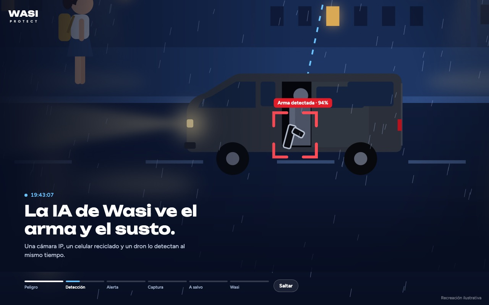
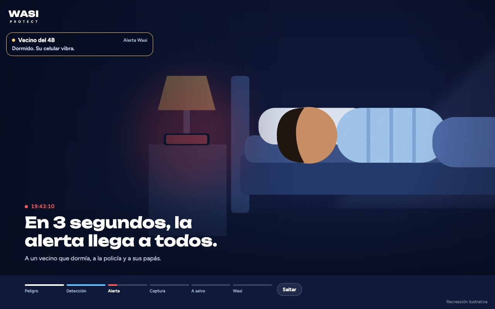
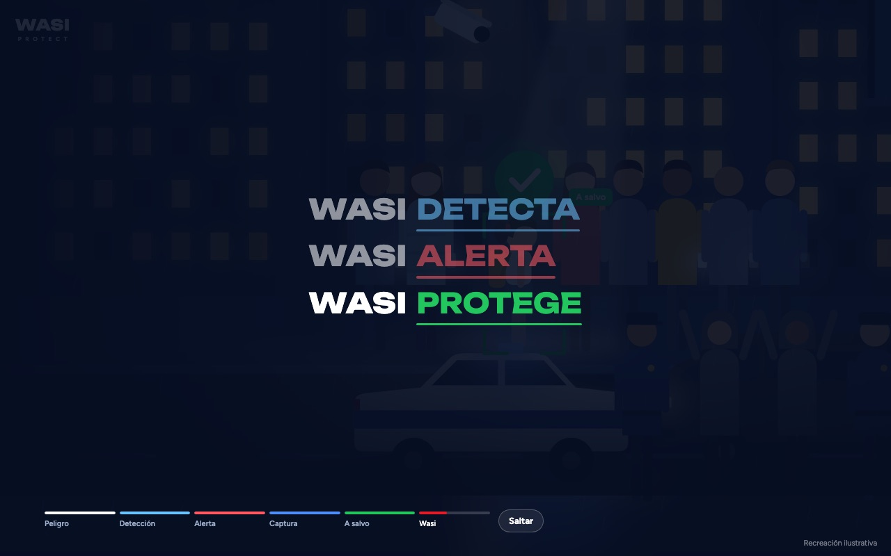

# Wasi Protect · Historia animada

Video interactivo de unos 40 segundos que cuenta, en una sola escena, cómo funciona **Wasi**: la IA detecta el peligro, la alerta llega a toda la comunidad y la niña termina a salvo. Cierra con la marca: **Wasi detecta · Wasi alerta · Wasi protege · Wasi somos todos · Únete**.

Hecho con **Expo (React Native)**, **Skia** y **Reanimated**. El mismo código funciona en **web, iOS y Android**.

| Detección | Alerta |
| --- | --- |
|  |  |
| **Wasi detecta · alerta · protege** | **Wasi somos todos · Únete** |
|  |  |

---

## Inicio rápido

Necesitas **Node.js 20 o superior**.

```bash
git clone git@github.com:DiegoFrans2024/wasi-hero.git
cd wasi-hero
npm install          # instala todo y prepara Skia para la web
npm run web          # abre la historia en el navegador
```

Se abre en **http://localhost:8081**.

### En el celular

```bash
npx expo start
```

Escanea el código QR con la app **Expo Go** (Android) o con la cámara (iPhone). Si alguna librería no carga en Expo Go, crea una *development build* con `npx expo run:ios` o `npx expo run:android`.

---

## La historia, segundo a segundo

| Segundo | Momento | Qué pasa |
| --- | --- | --- |
| 0 | **Peligro** | Valentina, 9 años, vuelve sola a casa. Una camioneta se detiene a su lado. |
| 6 | **Detección** | Una cámara IP, un celular reciclado y un dron detectan el arma y el susto. |
| 12 | **Alerta** | En 3 segundos la alerta llega a un vecino que dormía, a la policía y a sus papás. |
| 20 | **Captura** | Todos llegan. La policía detiene a los sospechosos. |
| 27 | **A salvo** | Valentina está a salvo. Nadie camina solo. |
| 33 | **Wasi** | Wasi detecta · Wasi alerta · Wasi protege → Wasi somos todos → **Únete** + App Store y Google Play. |

En el cierre, cada verbo usa el color de su momento en la historia: azul (detección), rojo (alerta) y verde (a salvo).

En la parte inferior hay una línea de tiempo: toca cualquier momento para saltar ahí, o usa **Saltar** / **Ver de nuevo**.

### Ver un momento exacto

Agrega `?t=` y el segundo a la dirección. La escena queda congelada ahí:

- `http://localhost:8081/?t=8.2` → el arma detectada
- `http://localhost:8081/?t=40.5` → el cierre completo

---

## Cambiar textos, tiempos y colores

Casi todo se edita en **`src/story/timeline.ts`**:

| Quiero cambiar… | Dónde |
| --- | --- |
| Títulos y subtítulos de cada momento | `STAGES` |
| Rótulos de los cortes (vecino, policía, papás) | `CUTS` |
| Verbos y colores del cierre (DETECTA, ALERTA, PROTEGE) | `BEATS` |
| Tiempos del cierre (Somos todos, Únete, tiendas) | `OUTRO` |
| Movimiento de la cámara | `KF` → `[segundo, x, y, zoom]` |
| Vibraciones del celular | `HAPTICS` |
| Colores y tipografías generales | `src/story/theme.ts` |

### Conectar los botones del final

El botón **Únete**, las insignias de las tiendas y "Ver cómo funciona" todavía no abren nada. Pásales las acciones en `App.tsx` y `App.web.tsx`:

```tsx
import { Linking } from 'react-native';

<HeroStory
  onJoin={() => Linking.openURL('https://…')}
  onAppStore={() => Linking.openURL('https://apps.apple.com/app/…')}
  onGooglePlay={() => Linking.openURL('https://play.google.com/store/apps/details?id=…')}
  onLearnMore={() => Linking.openURL('https://…')}
/>
```

---

## Estructura

```
App.tsx                 Entrada iOS/Android
App.web.tsx             Entrada web (carga Skia/WebAssembly primero)
src/story/
  timeline.ts           Textos, tiempos, cámara, cortes y cierre  ← lo más fácil de editar
  HeroStory.tsx         Pantalla: reloj de la historia, textos, línea de tiempo, vibración
  Outro.tsx             Cierre de marca: Wasi detecta/alerta/protege, Únete y tiendas
  StoryCanvas.tsx       Lienzo Skia + efectos (lluvia, sirenas, viñeta, grano)
  Street.tsx            La calle: personajes, vehículos, detección
  Interiors.tsx         Los tres cortes: vecino, policía, papás
  Figures.tsx           Personas (Valentina y adultos)
  Vehicles.tsx          Camioneta, patrulla y dron
  Hud.tsx               Etiquetas de la IA y rótulos de los cortes
  city.ts / math.ts / theme.ts
docs/                   Capturas para este README
```

Todo se anima en el hilo de UI con **Reanimated 4** y se dibuja en GPU con **Skia**, así que va fluido incluso en celulares modestos. En la web, Skia se carga como WebAssembly (`public/canvaskit.wasm`, que `npm install` genera automáticamente).

---

## Comandos

```bash
npm run web          # historia en el navegador
npx expo start       # servidor de desarrollo (QR para el celular)
npm run typecheck    # revisa tipos
npx expo lint        # revisa el código
npm run build:web    # versión web lista para publicar, en dist/
npx expo-doctor      # diagnostica dependencias
```

---

## Antes de publicar

- [ ] Conectar **Únete**, las tiendas y "Ver cómo funciona" a sus enlaces reales (ver arriba).
- [ ] Reemplazar las insignias de App Store y Google Play por las **oficiales** de Apple y Google (tienen reglas de uso de marca).
- [ ] Ajustar los porcentajes de la IA (94 %, 96 %) a los valores reales del producto; hoy son ilustrativos.
